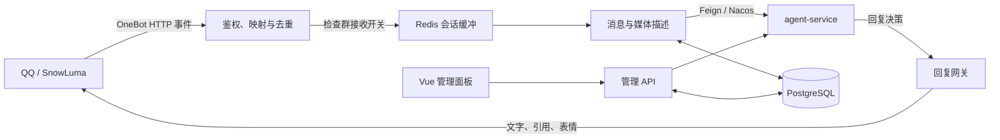

# chat-service

ATRIPlus 的 QQ 消息接入与回复网关。接收 SnowLuma OneBot v11 事件，将同一会话的消息聚合后交给 `agent-service` 决策，再发送文字、引用回复和表情。仓库同时包含 Vue 管理面板，用于管理群开关、媒体描述，以及查看 Agent 的聊天记录、记忆和模型调用信息。

主回复模型与记忆逻辑由独立的 `agent-service` 提供；本服务负责消息适配、缓冲、媒体描述和 QQ 回复发送。

## 功能与技术栈

- SnowLuma 群聊、私聊事件接入，支持 HMAC-SHA1 / Bearer 校验、自消息过滤和 Redis 事件去重。
- 按会话防抖、串行处理、分布式锁续租，按文本和原图预算拆批。
- 每轮最多发送 3 条文字，可引用本轮消息，也可发送纯表情或文字加表情。
- 图片与动画表情识别、描述缓存和人工编辑；支持媒体 URL 预览及永久忽略文件 ID。
- 群消息接收与 AI 回复独立控制；关闭回复时仍可将消息送到 Agent 存档。
- 管理面板：L1 记忆、提示词草稿与发布、聊天记录、互动片段、模型调用记录、群控制和媒体管理。
- 保留 RabbitMQ 兼容入口；**当前 RabbitMQ 回复发布器为空实现，不能用于完整收发闭环。**

后端使用 Java 21、Spring Boot 3.5.16、Spring Cloud OpenFeign / LoadBalancer、Nacos、Redis、PostgreSQL 和 MyBatis；前端使用 Vue 3、TypeScript、Element Plus 和 Vite。构建使用 Maven Wrapper 和 npm。

## 消息处理流程



1. `POST /onebot/v11/events` 先校验原始请求体，再解析事件；忽略非消息事件、机器人自身消息和无效目标。
2. 事件 ID 为 `<selfId>:<messageId>`，会话 ID 为 `qq:<selfId>:<group|private>:<targetId>`。成功接收后写入 Redis 并返回 HTTP 200，后台处理不阻塞 webhook；重复事件返回 200，正在接收的事件返回 202。
3. 空闲会话在最后一条消息后等待 5 秒，后台每秒扫描。同一会话的一轮处理包含描述、Agent 调用和回复发送；下一轮最早在 `max(本轮开始时间 + 8 秒, 本轮完成时间)` 启动，积压消息无需再等 5 秒。
4. 后台查询 OneBot `get_msg`，整理发送者、QQ、时间、文本、@、单层引用及媒体信息；查询失败时回退到事件快照。
5. 按预算截取队列前缀并请求 Agent。第一条回复文字可携带引用，后续文字分别发送，最后发送表情；每次发送前检查处理租约与群开关，并校验 OneBot `retcode=0`。

当前没有“收到 5 条立即刷新”或“单批最多 5 条”的限制。已消费批次处理失败时记录日志，**不会自动重放失败批次或部分已发送的回复**；webhook 接收成功不代表 QQ 回复已送达。

## 环境准备

| 依赖 | 用途 / 默认连接 |
| --- | --- |
| JDK 21 | 编译和运行后端，需配置 `JAVA_HOME` |
| Node.js / npm | 构建管理面板；按当前锁文件，可使用 Node.js 22.20+ 的 22.x 版本 |
| PostgreSQL | 群开关、昵称历史、媒体描述和管理数据，默认 `localhost:5432/atriplus` |
| Redis | 消息缓冲、幂等、处理锁和配置缓存，默认 `localhost:6379` |
| Nacos | 服务发现，使用 `SPRING_CLOUD_NACOS_DISCOVERY_SERVER_ADDR` 显式配置，如 `127.0.0.1:8848` |
| agent-service | 注册到同一 Nacos，服务名为 `agent-service` |
| SnowLuma | 默认 profile 的 OneBot HTTP API，默认 `http://127.0.0.1:3000` |
| RabbitMQ | 仅 `rabbitmq` profile 需要，默认 `localhost:5672` |

Maven Wrapper 首次运行需要下载 Maven；打包时 `npm ci` 也需要访问包仓库。

### 初始化数据库

先创建配置中的 PostgreSQL 数据库，再用业务数据库账号执行：

- [群开关建表脚本](docs/sql/qq-group-reply-config.sql)：新建群配置表，同时兼容为旧表增加 `receive_enabled`。即使关闭管理面板，群消息处理仍需要此表。
- [媒体描述建表与升级脚本](docs/sql/media-description.sql)：支持首次建表和已有表升级。

昵称历史使用 `qq_group_nickname`。新数据库可按当前 Mapper 契约建表：

```sql
CREATE TABLE IF NOT EXISTS qq_group_nickname (
    group_id BIGINT NOT NULL,
    qq_number BIGINT NOT NULL,
    nickname TEXT NOT NULL,
    updated_at TIMESTAMPTZ NOT NULL DEFAULT CURRENT_TIMESTAMP,
    PRIMARY KEY (group_id, qq_number, nickname)
);

CREATE INDEX IF NOT EXISTS idx_qq_group_nickname_latest
    ON qq_group_nickname (group_id, qq_number, updated_at DESC);
```

上述 `CREATE TABLE IF NOT EXISTS` 不会升级旧昵称表。已有表需要确认主键为 `(group_id, qq_number, nickname)`，并在清理空昵称后迁移；旧的二列主键不支持当前昵称历史写入。

启用管理面板时，应用会自动建立 `admin_l1_prompt_state`、`admin_l1_prompt_history` 和 `admin_l1_audit`，数据库账号需具备相应建表权限。其他业务表仍需提前初始化。

## 快速启动

以下命令在仓库根目录的 PowerShell 中执行。凭据占位符需要替换为本地实际值，不要提交真实配置。

```powershell
$env:POSTGRES_PASSWORD = "<数据库密码>"
$env:NACOS_PASSWORD = "<Nacos 密码>"
$env:SPRING_CLOUD_NACOS_DISCOVERY_SERVER_ADDR = "127.0.0.1:8848"
$env:SNOWLUMA_BASE_URL = "http://127.0.0.1:3000"
$env:SNOWLUMA_ACCESS_TOKEN = "<OneBot API token>"
$env:SNOWLUMA_WEBHOOK_TOKEN = "<事件推送 token>"

# 管理面板默认启用，必须配置密码与两端共享的内部令牌。
$env:ADMIN_PASSWORD = "<管理员密码>"
$env:ADMIN_INTERNAL_TOKEN = "<与 agent-service 一致的内部令牌>"

# 打包包含管理页面的可运行 JAR。
./mvnw.cmd package
java -jar target/chat-service-0.0.1-SNAPSHOT.jar
```

先启动 PostgreSQL、Redis、Nacos、SnowLuma 和配套的 `agent-service`，再启动本服务。默认 HTTP 端口为 `8080`，可通过 `SERVER_PORT` 修改。

启动后访问 [管理面板](http://localhost:8080/admin/)，用户名固定为 `admin`，密码为 `ADMIN_PASSWORD`。Agent 的管理功能还需要在 Agent 侧设置 `ADMIN_INTERNAL_ENABLED=true`，并使用相同的 `ADMIN_INTERNAL_TOKEN`；具体记忆后端配置由 Agent 项目负责。

只开发后端时，可用以下命令运行；`spring-boot:run` 不会自动执行前端打包阶段：

```powershell
./mvnw.cmd spring-boot:run
```

若不需要管理功能，在启动前设置 `$env:ADMIN_ENABLED = "false"`，此时无需提供管理密码和内部令牌，管理页面与 API 会被禁用。**当前 `application.yml` 中 `ADMIN_ENABLED` 默认值为 `true`；启用时缺少任一必需管理凭据会启动失败。**

### 配置 SnowLuma

参考 [OneBot 配置示例](docs/snowluma-onebot.example.json)：

- 开启 HTTP server，默认端口 `3000`；其 `accessToken` 对应 `SNOWLUMA_ACCESS_TOKEN`。
- 开启 HTTP client，将事件 POST 到 `http://<chat-service 地址>:8080/onebot/v11/events`，使用消息段数组格式，并关闭自身消息上报。
- HTTP client 的推送 token 对应 `SNOWLUMA_WEBHOOK_TOKEN`；支持 `X-Signature: sha1=<HMAC-SHA1(raw-body)>` 或 `Authorization: Bearer <token>`。
- 示例中的 `host.docker.internal` 用于容器访问宿主机，需要按实际网络修改；`SNOWLUMA_BASE_URL` 则必须能从 chat-service 所在环境访问 SnowLuma。

未显式配置 webhook token 时，默认复用 API token；最终 token 为空时会放行推送鉴权。

## 配置说明

主要配置位于 `src/main/resources/application.yml` 和各 profile 文件。也可在被忽略的 `src/main/resources/application-local.yml` 中保存本地凭据，由应用可选导入；不要将其提交或输出到日志。

| 环境变量 | 默认值 | 说明 |
| --- | --- | --- |
| `SPRING_PROFILES_ACTIVE` | 未设置时使用 `snowluma` | 选择 `snowluma` 或 `rabbitmq`，两者适配器互斥使用 |
| `POSTGRES_HOST` / `POSTGRES_PORT` / `POSTGRES_DB` | `localhost` / `5432` / `atriplus` | PostgreSQL 地址 |
| `POSTGRES_USERNAME` / `POSTGRES_PASSWORD` | `postgres` / 无 | 数据库凭据 |
| `SPRING_DATA_REDIS_HOST` / `SPRING_DATA_REDIS_PORT` | `localhost` / `6379` | Redis 地址，可用标准 Spring 属性补充密码等配置 |
| `SPRING_CLOUD_NACOS_DISCOVERY_SERVER_ADDR` | 项目未显式设置 | Nacos 服务发现地址 |
| `NACOS_PASSWORD` | 无 | Nacos 密码，用户名配置为 `nacos` |
| `SNOWLUMA_BASE_URL` | `http://127.0.0.1:3000` | OneBot HTTP API 地址 |
| `SNOWLUMA_ACCESS_TOKEN` | 空 | 调用 OneBot API 的 token |
| `SNOWLUMA_WEBHOOK_TOKEN` | 回退到 `SNOWLUMA_ACCESS_TOKEN` | 推送鉴权 token |
| `ADMIN_ENABLED` | `true` | 是否启用管理功能 |
| `ADMIN_PASSWORD` / `ADMIN_INTERNAL_TOKEN` | 空 / 空 | 启用管理功能时必须配置 |
| `MEDIA_VISION_BASE_URL` | `https://api.deepseek.com` | 视觉模型兼容接口地址，客户端追加 `/chat/completions` |
| `MEDIA_VISION_MODEL` | `deepseek-flash` | 视觉模型名称，需与所用服务的识图能力匹配 |
| `MEDIA_VISION_API_KEY` | 回退到 `DEEPSEEK_API_KEY` | 媒体识别密钥，未配置时识别不可用 |
| `RABBITMQ_HOST` / `RABBITMQ_PORT` | `localhost` / `5672` | 兼容链路地址 |
| `RABBITMQ_USERNAME` / `RABBITMQ_PASSWORD` | `guest` / `guest` | 兼容链路凭据 |

消息调度使用 `chat.buffer` 配置：

```yaml
chat:
  buffer:
    debounce-millis: 5000       # 空闲会话防抖
    min-interval-millis: 8000   # 同会话两轮实际开始时间的最小间隔
    max-text-chars: 32768      # 包含包装文本的字符预算，不是精确 token 数
    max-images: 8              # 单批原图预算
    lock-lease-millis: 120000  # 会话处理锁租期
    lock-renew-millis: 10000   # 独立线程续租，必须小于租期
```

超预算按消息顺序拆批；单条超限时截断正文并限制原图数。Redis Lua 保证入队、抢占、截取和完成衔接的原子性。事件接收去重另有 7 天已处理标记和 1 天处理锁，与上述会话处理锁不同。

## 管理面板

| 页面 | 路由 | 数据来源 / 说明 |
| --- | --- | --- |
| L1 记忆 | `/admin/tencentdb/l1/memories` | 通过 Agent 查询、编辑和删除 TencentDB L1 记忆 |
| L1 提示词 | `/admin/tencentdb/l1/prompts` | 本地保存草稿，发布到 Agent；支持版本冲突检查 |
| 聊天记录 | `/admin/chat-history` | 通过 Agent 查询会话历史 |
| 互动片段 | `/admin/style-learning` | 只读查看 Agent 风格学习片段，需 Agent 开启对应功能 |
| 模型调用记录 | `/admin/model-calls` | 查看提示词、参数、输出与决策，需 Agent 开启调用记录采集 |
| 消息接收 / AI 回复 | `/admin/group-reply-config/receive`、`/admin/group-reply-config/reply` | PostgreSQL 保存两个独立开关，Redis 缓存 |
| 图片 / 表情包 | `/admin/media/images`、`/admin/media/memes` | 本服务媒体描述库，支持分页、预览、编辑和删除 |

管理 API 使用管理员会话，写操作要求 CSRF。内部令牌由后端注入，不向浏览器返回。更多发布与操作细节见 [管理面板说明](docs/admin-panel.md)；如旧说明中的默认值与代码不同，以当前配置文件为准。

群开关行为：关闭接收时不再入队，并丢弃尚未送出的积压；接收开启、回复关闭时，发送 `replyEnabled=false` 给 Agent 存档并跳过回复模型；两者开启时由 Agent 决定是否回复。重新开启不会补发已丢弃或已存档的消息。

媒体预览由浏览器直接读取保存的 `source_url`，服务不下载本地副本。文件 ID 按完整原始字符串匹配，`name.jpg` 与 `name.png` 是不同记录。删除会保留永久墓碑：同一文件 ID 以后不再识别、转发原图或重新新增，也没有面板恢复入口。媒体描述库与发送表情用的 `memes/custom-faces.json` 是两套数据，详见 [媒体描述说明](docs/media-description.md)。

### 前端开发

先启动启用了管理功能的后端，再在另一个 PowerShell 窗口执行：

```powershell
Set-Location admin-web
npm.cmd ci
npm.cmd run dev
```

打开 Vite 输出地址下的 `/admin/`。`admin-web/vite.config.ts` 默认将 `/api/admin` 代理到 `http://127.0.0.1:8080`；后端端口变化时同步调整代理。`npm.cmd run build` 执行 TypeScript 检查并生成 `admin-web/dist/`。

## Agent 接口契约

通过 Nacos 服务名 `agent-service` 调用 `POST /api/agent/chat`，请求示例：

```json
{
  "conversationId": "qq:10001:group:20001",
  "replyEnabled": true,
  "messages": [
    {
      "eventId": "10001:30001",
      "senderName": "群友",
      "text": "整理后的消息描述",
      "images": []
    }
  ]
}
```

`images` 元素格式为 `{"file":"文件ID","summary":"简述","url":"https://..."}`。普通图片首次识别后传文字描述；首次动画表情可附原图 URL 并在后台识别，缓存命中后使用描述。引用图片只读已有描述，不发起识别或转发原图。`replyEnabled` 缺失或为 null 时默认允许 Agent 决策。

```json
{
  "shouldReply": true,
  "replies": ["第一条回复", "第二条回复"],
  "replyToEventId": "10001:30001",
  "meme": null
}
```

`replyToEventId` 只能引用本轮实际发给 Agent 的消息；无效引用会被忽略。`meme` 是 `src/main/resources/memes/custom-faces.json` 中的语义标签，按精确标签随机选择启用项；找不到表情不影响已发送文字。`shouldReply=false` 时不发送，`replies` 最多使用 3 条非空文字。修改 DTO、会话 ID、聚合语义或表情标签时，需同步核对配套 Agent 仓库（本地协作路径为 `E:\ATRLPLUS-AGENTS`）。

## RabbitMQ 兼容模式

```powershell
./mvnw.cmd spring-boot:run "-Dspring-boot.run.profiles=rabbitmq"
```

该模式提供 `POST /internal/messages` 和 `atriplus.qq.message.queue` 消费入口，兼容旧 payload 的 `senderName`、`text`、`conversationName`；消费者手动 ACK，解析失败或三次处理失败进入死信队列。默认 `snowluma` profile 不加载 RabbitMQ 适配器及自动配置。

队列与交换机定义集中在 `RabbitMqConfig`。当前 `ReplyEventPublisher.publish/send` 未实际发送，旧 `QQReplyEvent` 仍为单字符串回复协议；恢复回复链路需要同步升级 DTO、发布器及下游消费者。

## 构建与验证

```powershell
# 运行后端测试。
./mvnw.cmd test

# 测试、安装前端依赖、构建管理面板并打包后端。
./mvnw.cmd package

# 仅在已经完成前端构建、admin-web/dist 存在时复用产物。
./mvnw.cmd package "-Dexec.skip=true"

# 显式启用真实 Redis 的缓冲回归测试。
./mvnw.cmd test "-Dchat.buffer.redis-tests=true"
```

打包产物位于 `target/chat-service-0.0.1-SNAPSHOT.jar`；管理页面在 Maven `prepare-package` 阶段复制到 JAR 的 `static/admin/`。真实 Redis 测试默认连接 `127.0.0.1:6379`，可用 `chat.buffer.redis-host`、`chat.buffer.redis-port` 系统属性覆盖。

当前仓库忽略整个 `src/test/`，本地已有测试可供 Maven 验证，但新检出仓库可能不包含这些测试；不能只凭 Maven 执行成功认定已运行完整回归。开发时重点验证事件映射、鉴权、媒体描述、群开关、Redis 串行处理以及多条回复与引用顺序。修改主要流程时保留解释关键决策的注释。

## 目录结构

```text
admin-web/                         Vue 管理面板
docs/                              配置示例、部署说明和 SQL
src/main/java/com/atriplus/chat/
  client/                          Agent Feign 接口与 OneBot DTO
  config/                          profile、鉴权、线程池和连接配置
  consumer/                        RabbitMQ 消费入口
  controller/                      webhook、内部入口和管理 API
  dto/、event/                      统一消息及 OneBot 事件模型
  mapper/                          PostgreSQL 数据访问
  service/                         消息接入、幂等、昵称与群控制
    ai/                            Redis 缓冲、Agent 调用、媒体描述与回复
    admin/、media/                 管理逻辑与媒体存储
src/main/resources/
  application*.yml                 通用及 profile 配置
  mapper/                          MyBatis XML
  memes/custom-faces.json           回复表情库
```

## 常见问题

| 现象 | 检查项 |
| --- | --- |
| 启动提示缺少管理凭据 | 默认启用面板；设置 `ADMIN_PASSWORD`、`ADMIN_INTERNAL_TOKEN`，或明确关闭 `ADMIN_ENABLED` |
| webhook 返回 401 | webhook token、原始请求体签名和 `sha1=` 前缀；Bearer token 是否一致 |
| 消息收到但没有送到 Agent | Redis 连接、群接收开关、到期索引、处理租约，以及 Nacos 中 `agent-service` 的注册情况 |
| 群聊报数据库表或列不存在 | 是否执行群开关、媒体脚本；昵称表主键及 `receive_enabled` 是否已升级 |
| Agent 返回后没有 QQ 回复 | 群回复开关、`shouldReply`、回复内容、目标和 OneBot `retcode`；RabbitMQ 模式尚无回复发送 |
| 图片识别失败 | 视觉 API key、服务和模型的识图能力、模型服务能否访问原图 URL；失败不会中断整个消息批次 |
| 面板代理 `ECONNREFUSED` / 返回 403 | 后端是否监听代理目标；管理配置修改后是否重启；Agent 管理接口和两端内部令牌是否一致 |
| 媒体无法预览 | `source_url` 是否过期、浏览器能否直接访问；URL 失效不影响已保存描述 |

不要提交 `application-local.yml`、真实 SnowLuma 配置、凭据、`target/` 或前端构建缓存。升级消息调度实现时，先停止旧版本并等待处理任务结束，再启动新版本，保留 Redis 中的排队消息。
